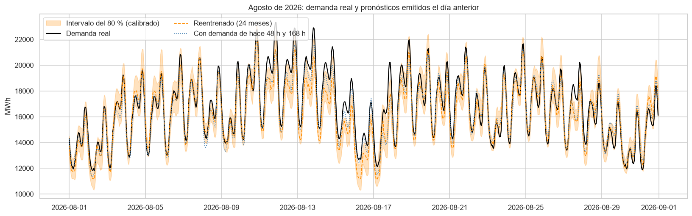
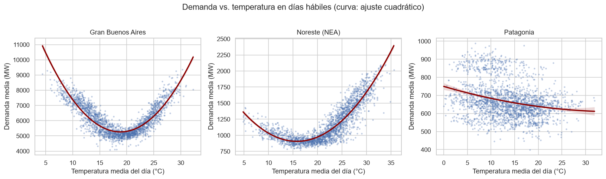
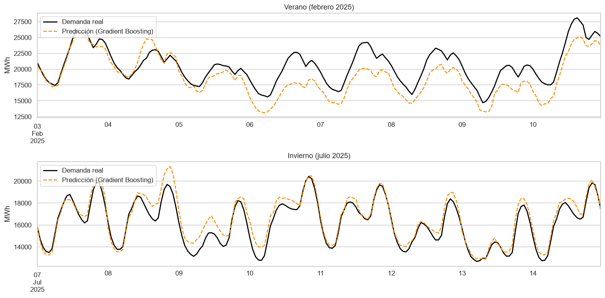
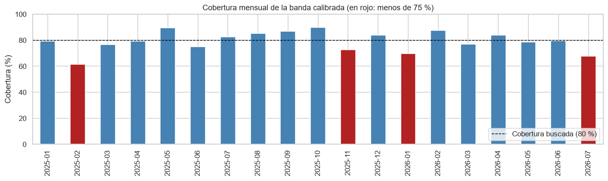
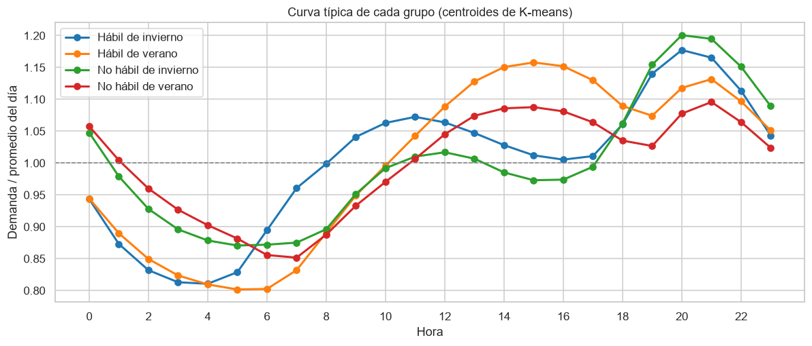
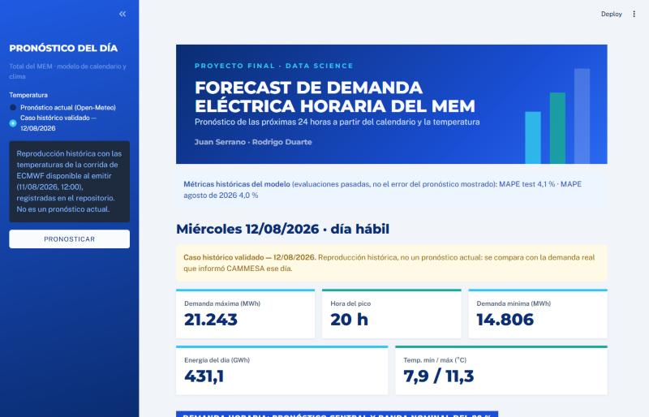

# Forecast de demanda eléctrica horaria del MEM argentino

Proyecto final del curso de Data Science — Programa Energía Digital 2026 (Fundación YPF + Jump Educación).

**Integrantes:** Juan Serrano · Rodrigo Duarte\
**Demo en vivo:** [forecast-demanda-mem.streamlit.app](https://forecast-demanda-mem.streamlit.app)\
**Detalle técnico:** [docs/detalles_tecnicos.md](docs/detalles_tecnicos.md)


*Agosto de 2026, un mes que no se usó en ningún paso del trabajo: demanda real (negro) y pronósticos emitidos el día anterior por el modelo reentrenado (naranja, con su banda del 80 %) y por la variante con demanda reciente (punteado azul).*

## El problema

CAMMESA, el operador del Mercado Eléctrico Mayorista (MEM), tiene que garantizar en todo momento que la generación iguale a la demanda: la electricidad no se almacena a escala de red. Para eso programa el despacho del día siguiente en base a un pronóstico de demanda. Cuanto mejor es ese pronóstico, menos reserva térmica hay que mantener encendida "por las dudas", con el consiguiente ahorro económico y de emisiones.

**Objetivo del modelo:** predecir la demanda eléctrica horaria del MEM (MWh) para las próximas 24 horas, a partir de variables de calendario (hora, día de semana, mes, tipo de día) y climáticas (temperatura).

## En pocas palabras

El trabajo se organizó alrededor de cinco preguntas:

1. **¿Qué mueve la demanda eléctrica hora a hora?** El EDA mostró tres ciclos superpuestos (diario, semanal y anual) y una relación en forma de **U** con la temperatura: la demanda es mínima entre los 18 y 19 °C y sube con el frío (calefacción) y, más todavía, con el calor (aire acondicionado). La hora del pico cambia con la estación: a la tarde en verano, a la noche en invierno.
2. **¿Se puede anticipar con solo calendario y temperatura?** Sí. Un Gradient Boosting se equivoca en promedio un **4,1 %**, contra 9,1 % de repetir la demanda de la semana anterior. En un mes que no se usó en ningún paso del trabajo (agosto de 2026), con reglas fijadas de antemano, dio **4,0 %**.
3. **¿Estamos midiendo bien?** Esta fue la pregunta que más trabajo llevó. El test se evalúa con el **pronóstico del tiempo** que existía al emitir, no con la temperatura que efectivamente hizo. Cada dato se usa solo si estaba disponible en ese momento. Dos revisiones críticas externas encontraron errores, y los corregimos (ver [revisión antes de la entrega final](docs/detalles_tecnicos.md#revisión-antes-de-la-entrega-final)).
4. **¿Dónde falla?** En los **picos**: acierta la hora del máximo diario, pero tiende a quedarse corto en su valor, sobre todo en las olas de calor. La banda de incertidumbre del 80 % cubre en promedio lo que promete, pero **falla en algunos meses**.
5. **¿Qué tipos de día existen?** Sin decirle el calendario, el clustering encontró cuatro perfiles de carga (hábil o no hábil, de verano o de invierno) y marcó como atípicos las fiestas, los feriados largos y el apagón del 1/3/2023.

El resultado se puede usar a través de una **API con FastAPI**, que devuelve el pronóstico de las 24 horas de un día con su banda y sus advertencias, y de una **demo con Streamlit** publicada en la web.

## Datos

| Fuente | Contenido | Uso |
|---|---|---|
| CAMMESA — demanda horaria (por tipo y por regiones) | Demanda real neta total del MEM, paso horario | Variable a predecir |
| Open-Meteo — modelo ECMWF IFS, Buenos Aires (Aeroparque) | Temperatura horaria histórica y, para el test, el pronóstico disponible al emitir | Variable climática del modelo |
| CAMMESA + SMN — demanda diaria por región con clima | 9 regiones, 2017–2026, con una estación del SMN por región | EDA regional |

Las dos planillas horarias de CAMMESA se encadenan en una única serie continua de **48.912 horas (2021-01-01 → 2026-07-31), sin huecos ni nulos**. **Alcance elegido:** total país (MEM), la serie que CAMMESA efectivamente pronostica para el despacho. Las fuentes, las validaciones y el armado del dataset regional están en el [detalle de los datos](docs/detalles_tecnicos.md#datos).

## Qué mueve la demanda (EDA)

Notebook [`01_eda_inicial.ipynb`](notebooks/01_eda_inicial.ipynb).

<p>

</p>

<p>

</p>

- La demanda va de ~9.300 a ~28.100 MW (media ~16.000), con tres estacionalidades superpuestas: diaria (valle 3–6 h), semanal (hábil > sábado > domingo) y anual con **dos picos**, verano (ene–feb) e invierno (jun–jul).
- **La hora del pico depende de la estación:** a la tarde (14–16 h) en verano, a la noche (20–21 h) en invierno. Esta interacción hora × temporada justifica probar modelos no lineales.
- Todas las horas récord de la serie son tardes hábiles de febrero (olas de calor). Se conservan: son los eventos que más importa acertar.
- GBA + Litoral + Buenos Aires concentran el 61 % de la demanda nacional, por lo que la temperatura de la región pampeana es la variable climática natural para el total país.
- La demanda tiene forma de **U** con la temperatura (mínimo en ~19 °C de temperatura media en GBA). La correlación lineal casi no la detecta, lo que refuerza el uso de modelos no lineales o de variables de grados-día.
- Las 11 variables climáticas del SMN quedaron alineadas y son consistentes en 2017–2026, pero no todas están listas para modelar: `HELIOF`, `TMAX` y `TMIN` tienen faltantes.

## Modelo supervisado

Notebook [`02_modelo_supervisado.ipynb`](notebooks/02_modelo_supervisado.ipynb). Predice la demanda horaria del MEM del día siguiente solo con calendario (hora, día de semana, mes, hábil/no hábil) y temperatura horaria de Buenos Aires, transformada en grados de calefacción y refrigeración con base en 18 °C, la zona de confort observada en los datos. Entrenamiento 2021–2024 y test ene-2025 → jul-2026, siempre por tiempo. Los hiperparámetros se eligen con validación cruzada temporal (`TimeSeriesSplit`), sin validaciones internas al azar (`early_stopping=False`).

El pronóstico del día D se supone emitido el día D-1 a las 12:00, y cada dato se usa solo si estaba disponible a esa hora ([reglas completas](docs/detalles_tecnicos.md#qué-se-conoce-al-emitir)).

| Modelo (regresión) | MAPE validación | MAPE test | WAPE test |
|---|---|---|---|
| Referencia: misma hora de la semana anterior | — | 9,1 % | 9,2 % |
| Referencia: perfil promedio | — | 7,6 % | 7,9 % |
| Regresión lineal | 6,3 % | 6,1 % | 6,2 % |
| Random Forest | 4,8 % | 4,3 % | 4,4 % |
| **Gradient Boosting (modelo de calendario y clima elegido)** | **4,5 %** | **4,1 %** | **4,2 %** |
| Gradient Boosting reentrenado cada mes (últimos 24 meses) | — | 4,1 % | 4,2 % |
| Variante con demanda de hace 48 h y 168 h | 4,1 % | 3,6 % | 3,7 % |

El WAPE (suma de errores sobre suma de demanda) pondera más las horas de mayor demanda. Con la temperatura histórica el Gradient Boosting daría 3,98 %: usar el pronóstico le suma 0,10 puntos. El pronóstico se aparta 0,7 °C en promedio de la serie histórica de ECMWF IFS; esa diferencia **no** es un error medido contra estaciones meteorológicas.

Clasificación de **horas de demanda alta** (sobre el percentil 90 de train): el Random Forest anticipa el 91,6 % con una precisión del 63 % (AUC-PR 0,870) y supera a la regresión logística.


*Una semana de verano y una de invierno del test. En julio el modelo sigue de cerca la curva; en esta semana de febrero se queda corto, sobre todo en los picos.*

**Análisis complementarios:**

- **Picos.** El modelo ubica bien la hora del máximo diario (88 % de los días a ±1 h), pero tiende a quedarse corto en su magnitud: en el 59 % de los días subestima el máximo, y en las horas de demanda alta el MAPE es 5,6 %. No es una imposibilidad matemática: el Gradient Boosting suma correcciones y puede predecir por encima del máximo de entrenamiento, aunque en este test nunca lo hizo (máximo predicho: 25.771 MWh, contra 27.433 MWh en train).
- **Días de calor extremo** (máxima por encima del percentil 95 de train, 30,9 °C). El error es un 24 % mayor (MAPE 4,9 % contra 4,0 %), sin sesgo claro: son días más inciertos.
- **Reentrenamiento mensual** con los últimos 24 meses (ventana elegida validando sobre 2024). Reduce el sesgo de 232 a 65 MWh y el de 2026 de 2,4 % a 1,0 %, pero no el error total.
- **Intervalos de predicción del 80 %.** Salen de regresión cuantil y se calibran con un método conformal elegido en una validación sobre 2024: ajuste único con los últimos 3 meses. Esa validación casi no distingue entre ventanas de 3, 6 y 12 meses ni frente a un ajuste por hora. Cubren el 79,1 % de las horas en promedio, pero **ese promedio no garantiza buena cobertura mensual**: según el mes van del 57 % al 93 %, en 5 de 19 meses quedan por debajo del 75 %, y ninguna alternativa probada lo corrige. Cuantifican la incertidumbre de la demanda; no equivalen a la reserva del sistema.
- **Demanda reciente.** Sumar la demanda de hace 48 y 168 horas, disponible al emitir, baja el MAPE a 3,6 %. Las dos versiones describen asociaciones predictivas, no causas. La variante se eligió con validación en train, pero el test ya había sido usado para explorarla, así que no es una prueba independiente.


*Cobertura de la banda del 80 % mes a mes en el test: en rojo, los meses por debajo del 75 %.*

**Limitaciones:**

- **Supuestos de operación.** La hora de emisión, la hora reservada para entrenar, la medición de la demanda en tiempo real y las demoras de publicación de la temperatura son supuestos documentados, no el procedimiento oficial de CAMMESA.
- **Temperatura de modelo.** Tanto la temperatura histórica como la pronosticada son del modelo ECMWF IFS, no mediciones de estación. Los errores de temperatura que se reportan son diferencias entre esas dos series.
- **Subestimación de 2026.** La causa no está del todo identificada: comparando enero–julio de cada año, la demanda creció solo 0,9 %.
- **Una sola ciudad.** La temperatura de Buenos Aires no captura las olas de calor nacionales.
- **Calendario binario.** Hábil / no hábil no distingue vísperas, puentes ni vacaciones.
- **Intervalos.** Hay subcobertura en meses puntuales: febrero, junio y noviembre de 2025 y enero y julio de 2026 quedan por debajo del 75 %.
- **Período de test reutilizado.** Las revisiones se evaluaron sobre el mismo período de test. Agosto de 2026, evaluado con un protocolo pre-registrado (notebook 04), confirma el orden de los modelos y el nivel de error, pero es un solo mes de invierno.

## Evaluación en un período nuevo: agosto de 2026

Notebook [`04_evaluacion_agosto_2026.ipynb`](notebooks/04_evaluacion_agosto_2026.ipynb). El período de test del notebook 02 se usó varias veces durante las revisiones, así que dejó de ser una medición independiente. Agosto de 2026 no se había usado en ningún paso. Antes de descargar su demanda se guardó un commit (`40e41df`) que fija los modelos y las métricas a reportar ([protocolo completo](docs/detalles_tecnicos.md#protocolo-de-la-evaluación-de-agosto-de-2026)).

| Modelo | MAPE agosto 2026 | MAPE agosto 2025 (ya examinado) | MAPE test completo (ya examinado) |
|---|---|---|---|
| Referencia: misma hora semana anterior | 9,3 % | — | 9,1 % |
| Referencia: perfil promedio | 7,6 % | — | 7,6 % |
| Gradient Boosting fijo | 4,3 % | 3,2 % | 4,1 % |
| Gradient Boosting reentrenado (24 meses) | 4,0 % | 3,2 % | 4,1 % |
| Variante con demanda de hace 48 h y 168 h | 3,3 % | 2,8 % | 3,6 % |

- **Se confirma:** el orden de los modelos se mantiene, y el error queda en el rango del test. Es la primera evidencia independiente de la variante con demanda reciente.
- **Empeora o falla:** el error es más alto que en agosto de 2025, y todos los modelos subestiman (el reentrenado, 436 MWh en promedio). La **banda del 80 % cubre solo el 72,4 %** de las horas, con la demanda por encima el 26 % del tiempo: la subcobertura de los intervalos se repite en un mes nuevo.
- **Sensibilidad:** CAMMESA revisó junio de 2026 después de publicarlo. Con junio revisado, el MAPE no cambia (3,98 %) y la cobertura pasa a 74,2 %.
- **Alcance:** es un solo mes de invierno. No valida el desempeño en verano ni en olas de calor, ni la calibración de la banda.

## Modelo no supervisado: días típicos y atípicos

Notebook [`03_clustering.ipynb`](notebooks/03_clustering.ipynb). Cada día (2.038, de 2021 a jul-2026) se describe con sus 24 demandas horarias divididas por el promedio del día, para agrupar por **forma** de la curva y no por nivel. El tipo de día, el mes y la temperatura no entran al clustering: se usan después para interpretar.

**K-means (k = 4)**, con k elegido por codo y silueta. Encuentra cuatro perfiles de carga con sentido físico:



| Grupo | Días | Forma de la curva |
|---|---|---|
| Hábil de invierno | 847 | Dos picos: mañana (~11 h) y noche (~20 h) |
| Hábil de verano | 480 | Pico de tarde (14–16 h), por el aire acondicionado |
| No hábil de invierno | 428 | Sin pico de mañana; pico de noche muy marcado |
| No hábil de verano | 283 | La más plana; incluye días hábiles de vacaciones de enero y febrero |

- **PCA:** dos componentes explican el 79 % de la variación. Una es el "pico de la tarde" (eje verano ↔ invierno) y la otra la "madrugada alta, mañana baja" (eje no hábil ↔ hábil).
- **Los grupos los marca más la temperatura que el calendario:** los meses de transición se reparten según haga calor o no.
- **DBSCAN** no encuentra grupos separados: los días forman un continuo (silueta de K-means ~0,37). Usado como detector de anomalías, marca un 4 % de días atípicos: fiestas de fin de año, carnavales, Semana Santa, días de calor extremo y el **apagón del 1/3/2023**, que detectó sin información externa.

## API y demo

**API con FastAPI** (`api/main.py`). Sirve el modelo evaluado en agosto de 2026 (`gb_calendario_clima_2026-08-01`) y pronostica las 24 horas de un día:

| Endpoint | Qué hace |
|---|---|
| `GET /salud` | Estado de la API y snapshot cargado |
| `GET /modelo` | Metadatos del snapshot, su antigüedad y los resultados medidos para ese artefacto exacto |
| `POST /pronostico` | Demanda de cada hora, banda de nivel nominal 80 %, resumen, bloque `alcance` y advertencias |

- Con solo la fecha, consulta el pronóstico de ECMWF IFS en Open-Meteo. También acepta las temperaturas como simulación manual, que es el modo evaluado.
- Usa las mismas reglas que la evaluación (variables de clima y banda), y hay pruebas que verifican que da exactamente los mismos valores que el pipeline evaluado.
- Cada respuesta dice su **alcance**: modo, fuente meteorológica, antigüedad del modelo y qué tan comparable es con la evaluación. El 80 % de la banda es el nivel nominal; la API no promete esa cobertura.
- Se niega a arrancar si el archivo del modelo no coincide con su huella sha256 o si cambia la versión de scikit-learn.

**Demo con Streamlit:** [forecast-demanda-mem.streamlit.app](https://forecast-demanda-mem.streamlit.app). Usa la misma función que el endpoint, sin lógica propia. Tiene dos modos: el pronóstico de un día con el clima actual de Open-Meteo, y un caso histórico validado (12/08/2026) que se compara con la demanda real de CAMMESA.



El diseño completo de la API (modos, errores, snapshots, reproducibilidad) y de la demo está en el [detalle técnico](docs/detalles_tecnicos.md#diseño-de-la-api-fastapi).

## Reflexión: sesgos, límites y uso responsable

**Sesgos del modelo**

- **Sesgo geográfico.** El modelo pronostica la demanda de todo el país con la temperatura de **una sola ciudad**, Buenos Aires. Funciona porque GBA, Buenos Aires y el Litoral son el 61 % de la demanda, pero el modelo "ve" el clima de la región pampeana y no el del NEA, el NOA o la Patagonia. Una ola de calor en el norte que no llegue a Buenos Aires puede quedar subestimada.
- **Errores asimétricos en el lugar más caro.** El modelo se queda corto en los máximos diarios (en el 59 % de los días del test y en el 74 % de agosto de 2026). Para un operador, quedarse corto en el pico es el error más costoso, porque puede dejar al sistema con menos reserva de la necesaria. El error promedio bajo esconde esa asimetría.
- **Sesgo temporal.** El modelo aprende el nivel de demanda de los años de entrenamiento, que incluyen la recuperación pospandemia y la recesión de 2024. Si cambia el nivel de actividad económica, el modelo se desajusta hasta que se reentrena: subestimó un 2,4 % en 2026.
- **Calendario simplificado.** Hábil / no hábil no distingue vísperas, puentes ni vacaciones de verano, y el clustering mostró que los días hábiles de enero se comportan como fines de semana. En la API, además, los feriados futuros los tiene que indicar el usuario: si se olvida, el día se pronostica como hábil.

**Límites de los datos**

- La temperatura es la de un **modelo meteorológico** (ECMWF IFS), no mediciones de estaciones.
- Las fuentes oficiales también tienen errores y revisiones. La planilla horaria de CAMMESA traía 4 días con el tipo de día mal etiquetado, y CAMMESA revisó los datos de junio de 2026 después de publicarlos. Por eso cada dato se valida contra otra fuente antes de usarlo.
- Los supuestos sobre **cuándo** se conoce cada dato (hora de emisión, demoras de publicación) son razonables y están documentados, pero no son el procedimiento oficial de CAMMESA.

**Qué es y qué no es este modelo**

- Es un **insumo** para planificar, no una herramienta de despacho. No conoce la oferta (centrales disponibles, mantenimientos, importaciones), los precios ni las fallas de la red, como el apagón de 2023.
- Describe **asociaciones** entre la demanda, el calendario y el clima. No dice qué *causa* la demanda.
- La banda del 80 % cuantifica la incertidumbre del pronóstico, pero **no es la reserva** que necesita el sistema, y no está bien calibrada en todos los meses.

**Uso responsable**

- **Transparencia en el punto de uso.** Cada respuesta de la API incluye un bloque `alcance` con el modo, el historial térmico, la fuente meteorológica, la antigüedad del modelo y qué tan comparable es con la evaluación. También trae advertencias: que el 80 % de la banda es nominal y la cobertura real fue menor en algunos meses, que un feriado no indicado se toma como hábil, que una consulta sobre una fecha pasada no es un backtesting y que una temperatura fuera del rango de entrenamiento hace menos confiable el pronóstico.
- **Una persona decide.** El pronóstico tiene que pasar por alguien que conozca el sistema, sobre todo en los días atípicos (fiestas, feriados largos, olas de calor), donde el modelo es menos confiable.
- **Evaluación honesta.** Las métricas se reportan aunque empeoren. La evaluación en un período nuevo se pre-registró antes de ver los datos, y la desviación que hubo quedó documentada. Cuando una revisión encontró una afirmación exagerada, la corregimos en lugar de defenderla.
- **Datos.** Se usaron solo datos públicos y agregados (demanda total del país y temperatura). No hay datos personales.
- **Impacto.** La motivación del proyecto es ambiental y económica: un mejor pronóstico permite mantener menos reserva térmica encendida "por las dudas". Pero un pronóstico demasiado optimista tiene el efecto contrario, y por eso la subestimación de los picos es la limitación más importante.

## Uso de IA en el proyecto

El trabajo se hizo con dos asistentes de IA, con roles complementarios, y con las decisiones y la validación a cargo del equipo.

| Quién | Rol |
|---|---|
| **Juan Serrano y Rodrigo Duarte** | Elección del problema y de las fuentes. **Todas las decisiones de diseño**: cada una se planteó como opciones con sus ventajas y desventajas, y la eligió el equipo (separación de train y test, modelo sin demanda pasada, cómo tratar la tendencia, qué incluir en la API). Rodrigo armó la primera versión del dataset regional con los datos del SMN y confirmó con el diccionario de datos del SMN el tratamiento de la precipitación. Revisión de cada entrega e incorporación de las devoluciones de la tutora. |
| **Claude (Claude Code, de Anthropic)** | Asistente de programación y ejecución: escribió y ejecutó los scripts y notebooks, bajó y validó los datos, propuso las opciones de diseño, explicó cada decisión y aplicó las correcciones de las revisiones. Al verificar los datos corrigió el error de lectura del archivo del SMN que corría columnas, amplió de 2 a 4 los días mal etiquetados de CAMMESA que había señalado una auditoría y detectó que la temperatura histórica era de ECMWF IFS y no de ERA5. |
| **ChatGPT (OpenAI)** | Ideas y revisión crítica: propuestas de mejora y dos **auditorías** completas del repositorio. La primera señaló, entre otras cosas, que el pronóstico del tiempo no correspondía a un único momento de emisión. La segunda, que el reentrenamiento usaba datos posteriores a la emisión. |

**Cómo se complementaron.** Un asistente construía y el otro revisaba. Ninguna observación de una auditoría se aplicó sin verificarla antes contra los datos: algunas se confirmaron, otras se matizaron, y en un caso la verificación encontró algo distinto de lo que decía la auditoría (la serie de temperatura no era ERA5, como suponía la revisión, sino ECMWF IFS).

**Lo que aprendimos del uso de IA.** Los asistentes también se equivocan, y sus errores suenan convincentes. Durante el trabajo aparecieron afirmaciones demasiado fuertes, como que el ancho de la banda era "la reserva necesaria", que los árboles "no pueden" predecir valores altos o que un WAPE parecido al MAPE probaba un buen desempeño en los picos. También apareció un ejemplo mal elegido: un feriado presentado como día hábil. Todas se detectaron con revisión cruzada y verificación con los datos. La práctica que nos quedó: cada número del README sale de una ejecución, cada afirmación se contrasta con un gráfico o una tabla, y las reglas de evaluación se fijan antes de ver los resultados.

## Estructura del repositorio

```
forecast-demanda-mem/
├── README.md
├── requirements.txt
├── docs/
│   └── detalles_tecnicos.md   # datos, reglas de evaluación, revisiones, diseño de la API y de la demo
├── notebooks/        # numerados por etapa
│   ├── 01_eda_inicial.ipynb          # EDA (pre-entrega 2)
│   ├── 02_modelo_supervisado.ipynb   # regresión y clasificación (pre-entrega 3, ampliado en la 4)
│   ├── 03_clustering.ipynb           # días típicos y días atípicos: K-means, DBSCAN, PCA (pre-entrega 4)
│   └── 04_evaluacion_agosto_2026.ipynb  # evaluación pre-registrada en un mes que no se usó
├── src/
│   ├── descargar_demanda_mem.py   # baja las planillas CAMMESA y arma la serie 2021-2026
│   ├── descargar_temperatura.py   # baja la temperatura horaria histórica de Buenos Aires, ECMWF IFS (Open-Meteo)
│   ├── descargar_temperatura_pronosticada.py  # baja la corrida de ECMWF disponible al emitir cada día del test (Open-Meteo)
│   ├── construir_dataset_regional.py  # arma el dataset regional diario con clima (CAMMESA + SMN)
│   ├── modelo_demanda.py          # reglas y modelos fijados del notebook 02 (los usan el notebook 04 y la API)
│   ├── entrenar_modelo.py         # entrena un snapshot para una fecha objetivo (nunca sobrescribe)
│   └── preparar_agosto_2026.py    # prepara los datos de agosto de 2026 para la evaluación nueva
├── api/
│   └── main.py       # API con FastAPI que sirve el modelo
├── demo/
│   ├── streamlit_app.py   # demo con Streamlit: reutiliza la lógica de la API
│   ├── caso_historico.py  # caso histórico validado del 12/08/2026
│   ├── estilo.py          # estilo visual de la presentación (solo apariencia)
│   └── requirements.txt   # dependencias de la demo, separadas y fijadas
├── .streamlit/config.toml # tema de la demo: colores y tipografías de la presentación
├── models/
│   ├── gb_calendario_clima_2026-08-01/   # snapshot evaluado en agosto de 2026: modelo.joblib + metadatos.json
│   └── resultados_experimentos.json       # métricas atadas a la huella sha256 de cada artefacto
├── tests/            # pruebas automáticas de la API, el módulo, el entrenamiento y la demo
├── data/
│   ├── raw/          # descargas sin modificar (no versionadas en git)
│   ├── processed/    # datasets construidos y su procedencia (*.meta.json)
│   └── reference/    # correcciones de tipo de día reconciliadas con las fuentes de CAMMESA
└── reports/
    └── figures/      # gráficos exportados por los notebooks
```

## Cómo reproducir

```bash
pip install -r requirements.txt            # entorno fijado (Python 3.12)
python src/descargar_demanda_mem.py        # genera data/processed/demanda_horaria_mem.csv (--actualizar para bajar meses nuevos)
python src/construir_dataset_regional.py   # genera data/processed/dataset_demanda_por_region.csv
python src/descargar_temperatura.py        # genera data/processed/temperatura_horaria_ba.csv
python src/descargar_temperatura_pronosticada.py  # genera data/processed/temperatura_pronosticada_ba.csv
jupyter notebook notebooks/01_eda_inicial.ipynb
jupyter notebook notebooks/02_modelo_supervisado.ipynb
jupyter notebook notebooks/03_clustering.ipynb
python src/preparar_agosto_2026.py        # necesita la planilla actualizada de CAMMESA en data/raw/periodo_nuevo/
jupyter notebook notebooks/04_evaluacion_agosto_2026.ipynb
python src/entrenar_modelo.py --fecha-objetivo 2026-08-01 --destino <carpeta> --comparar-con gb_calendario_clima_2026-08-01   # reproduce el snapshot e informa si coinciden predicciones y sha256
python -m pytest tests                    # 70 pruebas automáticas (sin internet)
uvicorn api.main:app --reload             # levanta la API: documentación en http://127.0.0.1:8000/docs
pip install -r demo/requirements.txt && streamlit run demo/streamlit_app.py   # demo con Streamlit
```

Los datasets procesados ya están versionados, así que los notebooks corren sin descargar nada. `data/raw/` no se versiona; qué archivos crudos hacen falta para regenerar todo desde cero está en [reproducción: datos crudos y procedencia](docs/detalles_tecnicos.md#reproducción-datos-crudos-y-procedencia).
